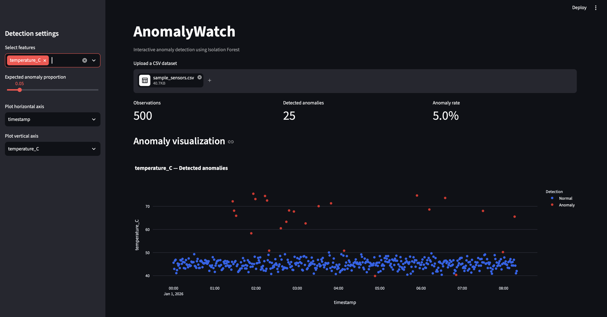
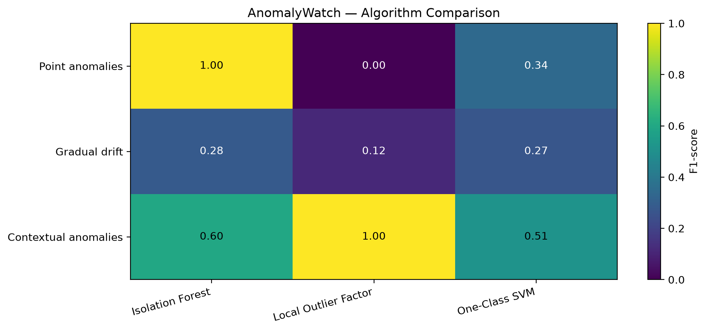

# AnomalyWatch

**Interactive anomaly detection and benchmarking for multivariate sensor data.**

AnomalyWatch is a lightweight Python application for exploring unusual observations in CSV datasets. It combines an interactive Streamlit dashboard with three unsupervised anomaly detectors, reproducible synthetic datasets, and an evaluation suite that compares detection performance across different anomaly types.

## Features

- Upload CSV files and select numerical input features.
- Switch between **Isolation Forest**, **Local Outlier Factor (LOF)**, and **One-Class SVM**.
- Adjust the anomaly detection sensitivity through the contamination/`nu` setting.
- Handle missing numeric values using median imputation and standardize model inputs.
- Visualize anomaly predictions and inspect observations ranked by anomaly score.
- Download annotated observations as CSV.
- Reproduce evaluations on synthetic datasets with known anomaly labels.
- Compare precision, recall, F1-score, and execution time across three anomaly scenarios.

## Tech stack

Python · Scikit-learn · Pandas · NumPy · Streamlit · Plotly · Matplotlib · pytest

## Installation

Python 3.11 or 3.12 is recommended.

```bash
git clone https://github.com/Hadis26/AnomalyWatch.git
cd AnomalyWatch
```

### Option A: Python virtual environment

**macOS / Linux**

```bash
python3 -m venv .venv
source .venv/bin/activate
python -m pip install --upgrade pip
python -m pip install -r requirements.txt
```

**Windows PowerShell**

```powershell
python -m venv .venv
.venv\Scripts\Activate.ps1
python -m pip install --upgrade pip
python -m pip install -r requirements.txt
```

### Option B: Conda

```bash
conda create -n anomalywatch python=3.11 -y
conda activate anomalywatch
python -m pip install -r requirements.txt
```

## Quick start

Generate an example dataset:

```bash
python -m scripts.generate_data
```

Launch the web app:

```bash
python -m streamlit run app.py
```

Open **http://localhost:8501**, upload `data/sample_sensors.csv`, select the numeric sensor columns (`temperature_C`, `vibration`, `pressure_kPa`), and choose a detection algorithm in the sidebar. The `injected_anomaly` column is a synthetic ground-truth label and **must not be selected as an input feature**.

If `assets/dashboard.png` has been added to the repository, the following image shows the interface:



## Methods

| Algorithm | Approach | Notes |
|---|---|---|
| **Isolation Forest** | Isolates observations with randomized decision trees | `contamination` determines the expected fraction classified as outliers in the training data |
| **Local Outlier Factor** | Compares each point's local density with its neighbors | Effective behavior depends on neighborhood size and the structure of anomalous groups |
| **One-Class SVM** | Fits a nonlinear boundary around observations | Uses `nu` (mapped from the UI sensitivity setting), **not** a fixed anomaly percentage |

All selected features are converted to numeric model inputs, missing values are imputed using feature medians, and features are standardized. Each model is fitted to the uploaded dataset; predictions therefore describe **in-sample anomaly detection**, not a held-out predictive test. Higher `anomaly_score` means more anomalous **within a given model**; numerical scores are not directly comparable between models.

## Reproducible evaluation

### Initial sensor dataset

The sample dataset contains **500 observations**, including **20 injected anomalies** in temperature, vibration, and pressure. With Isolation Forest at contamination `0.04`, the recorded results were:

| Metric | Value |
|---|---:|
| True positives | 20 |
| False positives | 0 |
| False negatives | 0 |
| True negatives | 480 |
| Precision | 1.000 |
| Recall | 1.000 |
| F1-score | 1.000 |

Reproduce:

```bash
python -m scripts.evaluate
python -m scripts.benchmark
```

### Benchmark across anomaly types

The extended benchmark considers **three synthetic datasets of 500 rows each**:

- **Point anomalies:** pronounced deviations from typical sensor readings.
- **Gradual drift:** a progressively changing sensor reading over time.
- **Contextual anomalies:** observations that violate relationships between measured variables.

The following F1-scores were recorded with the implementations' default configurations and sensitivity `0.04`:

| Dataset | Isolation Forest | LOF | One-Class SVM |
|---|---:|---:|---:|
| Point anomalies | **1.000** | 0.000 | 0.341 |
| Gradual drift | **0.283** | 0.117 | 0.268 |
| Contextual anomalies | 0.600 | **1.000** | 0.513 |



These results illustrate that performance depends on anomaly structure and model configuration. The low drift recall is partly due to a **fixed alert budget**: 100 drift observations are labeled anomalous, while contamination `0.04` targets roughly 20 flags for Isolation Forest and LOF.

Generate and evaluate all benchmark datasets:

```bash
python -m scripts.generate_benchmarks
python -m scripts.benchmark_suite
```

The suite saves `benchmark_results.csv`, `benchmark_results.json`, and `f1_heatmap.png` in `results/benchmarks/`.

**Runtime caveat:** reported algorithm timings are from individual local executions, not repeated hardware-controlled benchmarks. They should not be interpreted as general performance rankings.

## Testing

Run the unit tests:

```bash
python -m pytest tests/ -v
```

**Most recently verified: 10 tests passed**, covering detector behavior, reproducibility, preprocessing, validation, and all three algorithms. If `tests/test_benchmark.py` is present, it adds an additional benchmark integration test; that test is not included in the verified count above.

## Repository structure

```text
AnomalyWatch/
├── anomalywatch/
│   ├── __init__.py
│   └── detector.py
├── scripts/
│   ├── generate_data.py
│   ├── generate_benchmarks.py
│   ├── evaluate.py
│   ├── benchmark.py
│   └── benchmark_suite.py
├── tests/
│   └── test_detector.py
├── data/
│   ├── sample_sensors.csv
│   └── benchmarks/
├── assets/
│   └── dashboard.png
├── results/
│   ├── evaluation.json
│   └── benchmarks/
│       ├── benchmark_results.csv
│       ├── benchmark_results.json
│       └── f1_heatmap.png
├── .github/workflows/
├── app.py
├── requirements.txt
├── .gitignore
├── LICENSE
└── README.md
```

Some generated result files and the screenshot need to be created locally before the corresponding README links will render on GitHub.

## Limitations

- Training and evaluation currently use the same observations; reported scores are **not out-of-sample performance**.
- The synthetic anomaly distributions are simplified and do not establish real-world fault detection accuracy.
- Contamination is not a calibrated failure probability and has different semantics for One-Class SVM.
- Temporal structure is not explicitly modeled by these three detectors; gradual drift is especially sensitive to how data and thresholds are defined.
- Model selection and hyperparameter tuning would need separate validation data for a deployment-grade comparison.
- A detected statistical outlier is not automatically a physically meaningful equipment fault.

## References

- Liu, F. T., Ting, K. M., & Zhou, Z.-H. (2008). *Isolation Forest*. IEEE International Conference on Data Mining.
- Breunig, M. M., Kriegel, H.-P., Ng, R. T., & Sander, J. (2000). *LOF: Identifying Density-Based Local Outliers*. ACM SIGMOD.
- Schölkopf, B., Platt, J. C., Shawe-Taylor, J., Smola, A. J., & Williamson, R. C. (2001). *Estimating the Support of a High-Dimensional Distribution*. Neural Computation.
- [Scikit-learn anomaly detection documentation](https://scikit-learn.org/stable/modules/outlier_detection.html)
- [Streamlit documentation](https://docs.streamlit.io/)

## License

Released under the **MIT License**. See [LICENSE](LICENSE) for details.